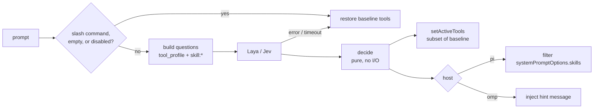

# pi-classifier-tools-skills

An extension for **Oh My Pi (omp)** and **pi** that uses a System-One classifier
(**Laya** by default, running locally, or **Jev** from TypeSafe) to choose the
**tools** and **skills** the model gets on each turn.

Before each turn, the prompt is classified once:

- one `choice` question picks a **tool profile** (for example `answer`, `edit`,
  `full`), and the turn runs with only that profile's tools active;
- one `noul` (yes/no) question per **skill** scores its relevance, and only the
  top-scoring skills are shown to the model.

The design follows
[pi-classifier-router](https://gitlab.com/ejstembler/pi-classifier-router),
which routes prompts to models. Its Jev/Laya clients and Laya worker are reused
here unchanged (MIT).



## Guarantees

- **It never breaks a turn.** A classifier failure, a timeout, or a bug restores
  the full loadout and shows a warning.
- **It never adds a tool.** A selection is always a subset of the **baseline**,
  the tools that were active before this extension changed anything. If you or
  another extension change tools mid-session, that becomes the new baseline.
- **"Don't know" keeps everything.** When no profile's risk is within `tools.maxRisk`,
  the answer is missing, or too many skills are candidates, all tools or all skills stay.
- **Every turn is recorded** as a `loadout.decision` session entry, failures included.

## Quick start

1. **Install the plugin.** This repository is also an omp marketplace:

   ```bash
   omp plugin marketplace add andrevandal/pi-classifier-tools-skills
   omp plugin install pi-classifier-tools-skills@andrevandal
   ```

   Or from a checkout:

   ```bash
   omp plugin install /path/to/pi-classifier-tools-skills   # omp
   pi install /path/to/pi-classifier-tools-skills           # pi
   omp -e /path/to/pi-classifier-tools-skills/src/index.ts  # one run, no install
   ```

2. **Install Laya** (the default backend). It runs as a local Python sidecar, so
   prompts never leave the machine. It needs Python 3.10+, and the first run
   downloads a multi-GB checkpoint from Hugging Face:

   ```bash
   pip install -r python/requirements.txt   # installs laya (and torch)
   ```

   Until Laya is installed, every turn keeps the full loadout and one warning
   says why (`laya import failed: ModuleNotFoundError`). To use Jev instead, set
   `"backend": "jev"` and `export TYPESAFE_API_KEY=...`.

3. **Start a new session** (extensions load at session start) and run
   `/loadout status`. To see what it would choose before letting it act, add
   `"dryRun": true` to `~/.omp/loadout.json`.

Upgrade a marketplace install with `omp plugin upgrade pi-classifier-tools-skills@andrevandal`.

## Host support

| | omp | pi |
| --- | --- | --- |
| tool selection | `setActiveTools` (async), applies to the current turn | `setActiveTools`, applies to the current turn |
| skill discovery | `getCommands()` entries with `source: "skill"` | `systemPromptOptions.skills` |
| skill application | **hint**: a hidden message names the relevant skills; every skill stays listed | **filter**: unselected skills are removed from the prompt for that turn |
| YAML config | yes (`Bun.YAML`) | no, use JSON |

omp's `before_agent_start` only exposes the rendered system prompt, so removing
skills there would mean editing prompt text. `skills.mode: "auto"` (the default)
therefore filters on pi and hints on omp. On omp, skill discovery needs
`skills.enableSkillCommands` left on (the default).

## Configuration

Searched in order; the first file that parses and validates wins:

1. `<project>/.omp/loadout.json` / `.yml` / `.yaml`, read **only when the project is trusted**
2. `~/.omp/loadout.json` / `.yml` / `.yaml`

A file with a bad value is rejected and the defaults apply. Unknown keys are
warnings. Sections merge one level deep over the defaults; `tools.question` and
`tools.profiles` are replaced as a whole and must cover the same options.

| key | default | meaning |
| --- | --- | --- |
| `enabled` | `true` | classify prompts at all |
| `backend` | `"laya"` | `"laya"` (local sidecar by default, or a shared host via `laya.transport: "http"`) or `"jev"` |
| `dryRun` | `false` | classify and record, never change anything |
| `notify` | `true` | show a one-line decision per turn; errors always show |
| `maxPromptChars` | `8000` | longest prompt sent to the classifier (min 200; `null` = no limit) |
| `tools.enabled` | `true` | select tools |
| `tools.question` | `answer` / `edit` / `full` choice | the `choice` question; its options are the profile ids |
| `tools.profiles` | see below | profile id -> tool names, or `"*"` for the whole baseline |
| `tools.alwaysOn` | `[]` | tools added to every profile (still limited to the baseline) |
| `tools.maxRisk` | `0.1` | most probability mass allowed on profiles broader than the chosen one; above it the baseline is kept. Profiles must be nested: each one's tools fit inside the next |
| `skills.enabled` | `false` | select skills; skipped above `maxCandidates`. Unmeasured: the bench and `npm run decisions` do not judge skill choices yet |
| `skills.mode` | `"auto"` | `"auto"`, `"filter"` (pi only), or `"hint"` |
| `skills.threshold` | `0.5` | minimum yes-probability for a skill to be selected |
| `skills.maxSkills` | `5` | most skills selected per turn |
| `skills.maxCandidates` | `40` | above this many skills, selection is skipped (cost bound) |
| `skills.alwaysInclude` | `[]` | always selected, never asked about |
| `skills.exclude` | `[]` | never asked about, never hidden |

Set `LOADOUT_CONFIG=/path/to/file.json` to use exactly that file and skip the
search, e.g. to pin one session's config from outside the project.

The `jev` and `laya` sections are the same as in pi-classifier-router (endpoint,
token variable, timeouts, local sidecar or HTTP transport).

**Default profiles.** These name tools from both hosts. Names a host does not
have are ignored.

| profile | tools |
| --- | --- |
| `answer` | `read grep find ls glob lsp web_search todo` |
| `edit` | `answer` + `edit write ast_edit` |
| `full` | `*` (whole baseline) |

pi only activates `read bash edit write` by default, so there `answer` leaves
just `read`. Enable more tools in pi, or put them in `tools.alwaysOn`.

See [`examples/loadout.json`](examples/loadout.json) for an omp config with a
`research` profile and Laya over HTTP.

## Command

`/loadout [status|explain|on|off]`

- `status`: config source, baseline tools, last decision.
- `explain`: last decision in full, including every skill's score.
- `on` / `off`: toggle for this session; `off` restores the baseline.

## Trade-offs

- **Latency.** One classifier round trip per turn, bounded by the backend's
  `timeoutMs` (+250 ms guard). Laya's sidecar costs roughly 200-460 ms per
  prompt on CPU and tens of ms on a GPU, after a slow first weight load that
  runs in the background at session start. Jev is a network call (3 s budget).
- **Prompt cache.** Changing tools or skills changes the system prompt and tool
  list, which can invalidate the provider's cached prefix. Fewer, coarser
  profiles mean fewer changes. Nothing is called when the selection already
  matches the active tools.
- **Cost scales with skills.** Every candidate skill is one more `noul`
  question per turn. `maxCandidates` caps this, and `exclude` / `alwaysInclude`
  take skills out of the question set.
- **Wrong narrowing costs more than no narrowing.** Taking `bash` away from a
  turn that needed it hurts more than leaving it available. Keep
  `tools.maxRisk` conservative and use `dryRun` + `/loadout explain` to
  tune profiles against your real prompts.
- **Laya accuracy.** Base checkpoints are close to chance on custom questions.
  Use Jev, or a Laya checkpoint fine-tuned on your question set.
- **Privacy.** The default Laya sidecar keeps everything local. With Jev, prompt
  text (clipped to `maxPromptChars`) and skill names and descriptions are sent
  to TypeSafe.

## Benchmarking

Does selection actually help on *your* work? Two scripts answer that from the
session transcripts omp already writes.

### A/B benchmark: `npm run bench`

Runs the same tasks headless (`omp -p`) in two git worktrees of your project:

| arm | config | purpose |
| --- | --- | --- |
| `loadout` | your config | the plugin selects tools and skills |
| `control` | your config + `dryRun: true` | classifies and records, changes nothing |

Both arms pay the classifier's overhead, so differences come from the selection
itself. Each arm gets its config through `LOADOUT_CONFIG` (so the worktrees stay
clean). It also runs in its own folder, so `omp stats` shows the arms separately.

```bash
cp bench/tasks.example.json my-tasks.json    # then write tasks from your real work
npm run bench -- --repo ~/code/my-project --tasks my-tasks.json --model <model> --runs 2 --setup "npm ci"
```

A task is `{ "id", "prompt", "check"?, "expect"? }`. `check` runs in the worktree after the
agent finishes, and exit 0 counts as a pass, e.g. `npm test`, or `git diff --quiet`
for "should not have changed anything". `$BENCH_LOG` holds the agent's output,
so a question can be graded too, e.g. ask for a final `ANSWER: ...` line and
`grep` for it. Before every run the worktree is reset
to `--ref` (`git reset --hard` + `git clean -fd`; ignored files such as
`node_modules` are kept). The arm that goes first alternates per task.

Output in `bench-results/<timestamp>/`:

- `summary.md`: header, per-arm totals and `loadout vs control` deltas (pass rate, cost, input
  tokens, cache rate, requests, errors, tool calls, wall time), then a `## Selection` section
  (below), then the per-task tables.
  If more than 5% of runs have no usable decision, or the two arms chose different profiles for
  any prompt, the summary starts with `**INVALID**` and the script exits 2.
- `results.jsonl`: one row per run, including the chosen profile, its risk, the classifier
  failure (if any), selected skills and classifier latency.
- `logs/`: agent output and check output per run.

How to read it:

| result | meaning |
| --- | --- |
| lower cost and input, same pass rate | selection helps |
| lower input, but flat cost and lower cache rate | tool churn is breaking the prompt cache; use fewer, broader profiles |
| lower pass rate | wrong narrowing; lower `tools.maxRisk` or fix the profiles |
| no difference | selection rarely acts; check risk with `npm run decisions` |

Limits: use `--runs 2` or more, since LLM runs vary. Each run is a fresh
single-prompt session, so this understates the cache cost of changing tools
mid-conversation; compare a few long interactive sessions too. Subagents that
omp writes outside its sessions directory are not counted.

**Selection** asks whether the selector chose well, apart from cost. `expect` is the
profile a prompt needs (`answer`, `edit` or `full`); label it by hand from what the prompt
requires. Accuracy scores the control arm's classifier choice against `expect`. Over-narrowed
counts runs where the loadout applied a narrower profile than `expect`. Needed tool missing
counts tools the control run used that the loadout's active set lacked. Prompt tokens per
request compares the arms with a 95% bootstrap interval. The verdict is `PASS` only when no
needed tool was missing, the loadout passed at least as many checks as control, and that
interval lies below zero. Otherwise it reads `NOT PROVEN` with the reasons. Over-narrowing
is reported but does not decide the verdict.

### Evaluating the classifier: `npm run eval`

The bench measures a whole session, which is slow and noisy. `npm run eval` measures the
classifier alone: it sends each labeled prompt through the same backend and questions the
plugin uses, and reports the confusion matrix and how `tools.maxRisk` trades coverage
against over-narrowing (a prompt given a narrower profile than it needs, so a tool goes
missing).

```bash
npm run eval -- --mine --out my-labels.jsonl --since 30d   # first prompts from past sessions
# add "expect": "answer" | "edit" | "full" to each line by hand, then:
npm run eval -- --labels my-labels.jsonl --config my-config.json
```

`bench/labels.jsonl` holds the 16 prompts from the bench task files, labeled. Sixteen
labels are too few to recommend a `maxRisk`: even with no over-narrowing, the 95% upper bound
stays above 5%, so the script says so rather than guessing. Zero over-narrowing needs at least
73 labels to meet that bound. The script exits 2 when every label fails, so a dead backend is
not mistaken for a result. `--json` prints the same report as data.

### Benchmarking with a warm Laya server

Each `omp -p` run is a fresh process, so the local sidecar reloads the model every
time (about 40 s on CPU), which exceeds omp's 30 s extension-handler limit and
yields no decisions. Serve the model once and use the HTTP transport:

```bash
python python/laya_http_server.py --repo convaiinnovations/laya --router --port 8765
npm run bench -- --repo <repo> --tasks <tasks.json> --config bench/laya-http.example.json --runs 2
```

`bench/laya-http.example.json` only points the plugin at the server. The server binds to
127.0.0.1 by default. To serve another host, pass `--host <addr> --allow-remote` and set
`LAYA_SERVER_TOKEN`. A token in that variable is enforced on any host: every POST must then
send `Authorization: Bearer <token>`. The plugin sends it when `laya.apiKeyEnvVar` names an
environment variable holding that token; the example config leaves it empty, so set it to
`LAYA_SERVER_TOKEN` for a token-protected server. Request bodies over 1 MiB are refused with 413.

### Decision report: `npm run decisions`

Summarizes every `loadout.decision` entry: profile distribution, risk p10/p50/p90, the share
of turns that kept the baseline, failures by reason, selected skills and classifier latency.
Useful on your normal day-to-day sessions, or on one benchmark arm:

```bash
npm run decisions -- --since 7d
npm run decisions -- --folder wt-control --json
```

### `omp stats`

`omp stats` (dashboard) or `omp stats --json` breaks cost, tokens, cache rate
and errors down by folder, so the two benchmark worktrees appear as two rows.
It does not know about loadout decisions or task success, and its tool-usage
view is per tool and model rather than per folder. The scripts above cover
those.

## What has been tested

| Path | omp 18.6.1 | pi 0.87.1 |
| --- | --- | --- |
| Unit and end-to-end tests (`npm test`, fake host + stub server) | yes | yes |
| Loaded with `-e src/index.ts`, real binary | yes | yes |
| Installed from the `npm pack` tarball, no `-e` | yes | not yet |
| Installed via `.omp-plugin/marketplace.json` (local clone) | yes | n/a |
| Default config: Laya sidecar spawned, NDJSON round trip | yes, with a stand-in `laya` module | not yet |
| Real Laya checkpoints | **not yet** | **not yet** |
| Real Jev API | **not yet** | **not yet** |

The model-quality question, whether a base Laya checkpoint picks good profiles
and skills, is still open (see Trade-offs). Run with `dryRun: true` first.

## Development

```bash
npm install
npm test           # node --test; Laya tests skip without python3
npm run typecheck
npm run lint
```

| file | role |
| --- | --- |
| `src/index.ts` | host wiring: events, per-session state, shared classifiers, `/loadout` |
| `src/select.ts` | pure logic: questions, tool/skill decisions, prompt clipping |
| `src/config.ts` | discovery, trust gate, validation, defaults |
| `src/classify/*`, `python/` | Jev/Laya clients and the Laya worker (from pi-classifier-router) |
| `scripts/bench.ts`, `scripts/decisions.ts` | A/B benchmark and decision report over session transcripts |

## License

MIT. The classifier clients and Laya worker are from pi-classifier-router (MIT,
Edward J. Stembler). Laya and Jev are not bundled; see that project's
third-party notes.
