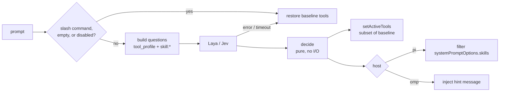

# pi-classifier-tools-skills

An extension for **Oh My Pi (omp)** and **pi** that uses a System-One classifier
(**Laya** by default, running locally, or **Jev** from TypeSafe) to choose the
**tools** and **skills** the model gets on each turn.

Before each turn, the prompt is classified once:

- one `choice` question picks a **tool profile** (for example `answer`, `edit`,
  `full`), and the turn runs with only that profile's tools active;
- one `noul` (yes/no) question per **skill** scores its relevance, and only the
  top-scoring skills are shown to the model.

The design follows
[pi-classifier-router](https://gitlab.com/ejstembler/pi-classifier-router),
which routes prompts to models. Its Jev/Laya clients and Laya worker are reused
here unchanged (MIT).



## Guarantees

- **It never breaks a turn.** A classifier failure, a timeout, or a bug restores
  the full loadout and shows a warning.
- **It never adds a tool.** A selection is always a subset of the **baseline**,
  the tools that were active before this extension changed anything. If you or
  another extension change tools mid-session, that becomes the new baseline.
- **"Don't know" keeps everything.** When no profile's risk is within `tools.maxRisk`,
  the answer is missing, or too many skills are candidates, all tools or all skills stay.
- **Every prompt it sees is recorded unless you opt out.** With telemetry on (the default) each prompt the host hands the plugin becomes one content-free `loadout.decision` session entry — skips and failures included — written after tools were applied, and each observed model turn becomes one `loadout.usage` entry. See [Telemetry](#telemetry).

## Quick start

1. **Install the plugin.** This repository is also an omp marketplace:

   ```bash
   omp plugin marketplace add andrevandal/pi-classifier-tools-skills
   omp plugin install pi-classifier-tools-skills@andrevandal
   ```

   Or from a checkout:

   ```bash
   omp plugin install /path/to/pi-classifier-tools-skills   # omp
   pi install /path/to/pi-classifier-tools-skills           # pi
   omp -e /path/to/pi-classifier-tools-skills/src/index.ts  # one run, no install
   ```

2. **Install Laya** (the default backend). It runs as a local Python sidecar, so
   prompts never leave the machine. It needs Python 3.10+, and the first run
   downloads a multi-GB checkpoint from Hugging Face:

   ```bash
   pip install -r python/requirements.txt   # installs laya (and torch)
   ```

   Until Laya is installed, every turn keeps the full loadout and one warning
   says why (`laya import failed: ModuleNotFoundError`). To use Jev instead, set
   `"backend": "jev"` and `export TYPESAFE_API_KEY=...`.

3. **Start a new session** (extensions load at session start) and run
   `/loadout status`. To see what it would choose before letting it act, add
   `"dryRun": true` to `~/.omp/loadout.json`.

Upgrade a marketplace install with `omp plugin upgrade pi-classifier-tools-skills@andrevandal`.

## Host support

| | omp | pi |
| --- | --- | --- |
| tool selection | `setActiveTools` (async), applies to the current turn | `setActiveTools`, applies to the current turn |
| skill discovery | `getCommands()` entries with `source: "skill"` | `systemPromptOptions.skills` |
| skill application | **hint**: a hidden message names the relevant skills; every skill stays listed | **filter**: unselected skills are removed from the prompt for that turn |
| YAML config | yes (`Bun.YAML`) | no, use JSON |

omp's `before_agent_start` only exposes the rendered system prompt, so removing
skills there would mean editing prompt text. `skills.mode: "auto"` (the default)
therefore filters on pi and hints on omp. On omp, skill discovery needs
`skills.enableSkillCommands` left on (the default).

## Configuration

Searched in order; the first file that parses and validates wins:

1. `<project>/.omp/loadout.json` / `.yml` / `.yaml`, read **only when the project is trusted**
2. `~/.omp/loadout.json` / `.yml` / `.yaml`

A file with a bad value is rejected: the plugin turns itself off, reports the error, and writes no telemetry until the file is fixed. Unknown keys are
warnings. Sections merge one level deep over the defaults; `tools.question` and
`tools.profiles` are replaced as a whole and must cover the same options.

| key | default | meaning |
| --- | --- | --- |
| `enabled` | `true` | classify prompts at all |
| `backend` | `"laya"` | `"laya"` (local sidecar by default, or a shared host via `laya.transport: "http"`) or `"jev"` |
| `dryRun` | `false` | classify and record, never change anything |
| `notify` | `true` | show a one-line notice per classified turn, after the tools were applied (skips get none); failures always show |
| `telemetry` | `true` | write the plugin's trace records (`loadout.decision`, `loadout.usage`); `false` writes none. A machine-wide `false` in `~/.omp/loadout.*` cannot be overridden (see [Telemetry](#telemetry)) |
| `maxPromptChars` | `8000` | longest prompt sent to the classifier (min 200; `null` = no limit) |
| `tools.enabled` | `true` | select tools |
| `tools.question` | `answer` / `edit` / `full` choice | the `choice` question; its options are the profile ids |
| `tools.profiles` | see below | profile id -> tool names, or `"*"` for the whole baseline |
| `tools.alwaysOn` | `[]` | tools added to every profile (still limited to the baseline) |
| `tools.maxRisk` | `0.1` | most probability mass allowed on profiles broader than the chosen one; above it the baseline is kept. Profiles must be nested: each one's tools fit inside the next |
| `skills.enabled` | `false` | select skills; skipped above `maxCandidates`. Unmeasured: the bench and `npm run decisions` do not judge skill choices yet |
| `skills.mode` | `"auto"` | `"auto"`, `"filter"` (pi only), or `"hint"` |
| `skills.threshold` | `0.5` | minimum yes-probability for a skill to be selected |
| `skills.maxSkills` | `5` | most skills selected per turn |
| `skills.maxCandidates` | `40` | above this many skills, selection is skipped (cost bound) |
| `skills.alwaysInclude` | `[]` | always selected, never asked about |
| `skills.exclude` | `[]` | never asked about, never hidden |

Set `LOADOUT_CONFIG=/path/to/file.json` to use exactly that file and skip the
search, e.g. to pin one session's config from outside the project.
The machine telemetry setting is still read from `~/.omp/loadout.*`.

The `jev` and `laya` sections are the same as in pi-classifier-router (endpoint,
token variable, timeouts, local sidecar or HTTP transport).

**Default profiles.** These name tools from both hosts. Names a host does not
have are ignored.

| profile | tools |
| --- | --- |
| `answer` | `read grep find ls glob lsp web_search todo` |
| `edit` | `answer` + `edit write ast_edit` |
| `full` | `*` (whole baseline) |

pi only activates `read bash edit write` by default, so there `answer` leaves
just `read`. Enable more tools in pi, or put them in `tools.alwaysOn`.

See [`examples/loadout.json`](examples/loadout.json) for an omp config with a
`research` profile and Laya over HTTP.

## Command

`/loadout [status|explain|stats|on|off]`. With no argument it runs `status`. `status`, `explain` and `stats` each send one notification: a block of text whose first line is `[loadout] <title>`. With `stats --json` or `stats export` the notification is the JSON document alone. That notification is shown even with `notify: false`. A usage error (an unknown subcommand, a bad `stats` argument) sends one warning. In print mode (`-p`) the host has no UI, so none of this output is shown.

- `status`: the settings in effect, the baseline tools, the last decision, the telemetry state and this session's counts. It prints no endpoint, environment variable name, Python path, repository or question text; `config:` shows where the settings came from.
- `explain`: the latest invocation in full: the outcome, the risk of each narrower profile, the proposal against the tools the host had afterwards, the ratchet, the skills and the classifier's evidence.
- `stats`: the figures of the session files (see below).
- `on` / `off`: toggle selection for this session; `off` restores the baseline.

`status` and `explain` read this process's memory only: they cover this session in this process and never read a file. `stats` reads session files through the same library as [`loadout-report`](#reporting-loadout-report), so it counts what is on disk, which can differ from what this process handed to the host.

### `status`

```text
[loadout] status
  selection: enabled | dry run off | notices on
  classifier: laya (http) | timeout 4000 ms
  config: ~/.omp/loadout.json (global)
  tools: profiles answer, edit, full (max risk 0.10) | skills: off
  baseline tools: read, bash, edit, eval, glob, grep, task, wait, todo, web_search, write, ast_edit, debug, lsp (14)
  last decision: applied answer (tools 6 of 14)
  telemetry: on (default) | records handed to host 10 | failed 0
  this session: prompts observed 5 (classified 4, failed 0, skipped 1) | model turns observed 5 | memory only, this session in this process
  not included: child and subagent sessions (each has its own plugin instance and records)
```

`config:` prints the path of the file the session loaded, as the plugin resolved it: an absolute path. The example shows it shortened to `~`.

### `explain`

Before the first prompt, `explain` says `[loadout] explain: nothing observed yet in this process`. The block below is the latest invocation of a dry run whose answer was low confidence and whose skills were over the candidate limit:

```text
[loadout] explain: latest invocation
  source: in memory | record handed to host
  outcome: dry run: would keep all tools (low confidence (closest narrower risk 0.15 > max 0.10)); skills: 3 candidates > limit 2, none asked
  tools: low confidence, no profile within max risk 0.10
    answer: p 0.55, risk 0.45 > 0.10
    edit: p 0.30, risk 0.15 > 0.10
    full: p 0.15 (broadest, the baseline)
  proposal: keep all tools (baseline)
  ratchet: - -> full (admitted, narrowing open)
  application: dry-run | actual tools: read, bash, edit, eval, glob, grep, task, wait, todo, web_search, write, ast_edit, debug, lsp (14)
  blocked: dry run, low confidence, skills over the candidate limit
  skills: 3 eligible > limit 2 (discovered 3): none asked, all skills kept
  classifier: 1 question (tools 1, skills 0) | prompt 30 chars, sent 30 (not clipped) | model smoke-stub-1 | tokens in 41, out 3
  timing: 6 ms of 4250 ms budget (timeout 4000 ms), guard not fired
  server: not reported | request 9ecd2f18-32eb-4ddd-86a9-9b2288244e93
  settings then: dry run on | max risk 0.10 | laya (http) | skills auto | config global
```

### `stats`

`/loadout stats [summary|export] [--json] [scope] [filters]`. `summary` (the default) prints the figures, and `export` prints the events behind them.

- **Default scope:** the host's current session file. The host writes it with the first assistant message, so before the first reply `stats` sends one info line that says there is no session file yet. A session that is never saved never writes one, so the line stays; name a scope instead. The arguments are checked first: a bad flag is a warning with the CLI's message even before the file exists.
- **Scope:** `--session <file>` names a file. A history is `--since <ISO> --until <ISO>` (events with since <= time < until) with `--project <path>` (the working directory must match exactly) or `--all-projects`. `--sessions-dir <dir>` replaces the root. The root defaults to OMP's, `~/.omp/agent/sessions`, whatever the host, so on pi pass the absolute path of pi's sessions directory. The host does not expand `~` in a path, so give `--session`, `--sessions-dir`, `--project` and `--service-log` absolute paths. Dates follow the same rules as `loadout-report`.
- **Filters:** `--branch <all|active|abandoned>`, `--outcome <value>` (repeatable), and `--service-log <file>` (a Laya server log for the request-id join; see [Telemetry](#telemetry)).
- **`--json`** prints the summary document and `export` prints the export document, as JSON with no prefix. They are the documents `loadout-report` prints. `--json` may appear anywhere on the line.
- **Cost:** a history scan reads the session files synchronously inside the host and blocks it until the scan finishes. Prefer `--project` and a short window.
- **`tool calls`:** the model-turn section counts a call only under a tool name the host had registered when the turn ended. A call to any other name, such as one the model made up, is left out, so `tool calls: N` can be less than the number of calls the model made (see [`docs/telemetry.md`](docs/telemetry.md) section 8).
- `stats --help` prints the usage.

```text
[loadout] stats: session files
  telemetry: on (default) | this process handed 10 records to the host, failed 0
  file: 5 decisions and 5 model-turn records were read here; this process handed 10 to the host (earlier history, or records the host has not written yet, explain a difference)
  scope: session files | files 1 (read 1, unreadable 0) | child sessions not read 0
  loadout decisions: 4 in 1 sessions (0 dry run)
  skipped: disabled 1
...
  classifier calls (loadout.decision attempts; not model turns): 4
    tokens: in 164, out 12
    server timing: reported 3, not reported 1 | queue p50 2.1 / p90 3.2 | inference p50 38 / p90 41.5
    guard fired: 0 yes, 4 no, 0 unknown | prompt clipped: 0 yes, 4 no, 0 unknown | request ids: 4 present, 0 absent
    models: smoke-stub-1 4
  model turns (loadout.usage; separate from classifier calls): 5 in 5 runs
    hosts: omp 5 | outcomes: stop 5
    assigned to a decision: 5, unassigned: 0
    tokens: input 60, output 10, cache read 0, cache write 0, reasoning unknown
    cost: 0.00008 (the host's own pricing, not a bill)
    tool calls: 0 | tool errors: 0
    retries: reported 0, unreported 5
  host transcript turns (the host's own messages, never added to the model-turn figures): 5
    tokens: input 60, output 10 | cost 0.00008
  service log: not read (--service-log <file> joins server records by request id)
  coverage: files read 1, unreadable 0, without header 0 | malformed lines 0 | unsupported records: decisions 0, model turns 0 | duplicates removed: decisions 0, model turns 0 | v2 decisions without event id 0
  read as: identifiers are local metadata; unknown is not zero; usage is observed, not billed; child sessions are not rolled up
```

A history with a missing bound or project is refused with one warning:

```text
[loadout] stats: incomplete historical scope: missing --until, --project <path> or --all-projects
[loadout] stats: incomplete historical scope: missing --project <path> or --all-projects
```

### Per-turn notices

After each classified turn, once the tools are applied, one info line says what happened:

```text
[loadout] applied edit (tools 9 of 14)
[loadout] kept edit: widen-only blocked narrowing to answer
[loadout] already matching edit (tools 9 of 14)
[loadout] applied answer (tools 6 of 14)
[loadout] dry run: would use answer (tools 6), nothing changed
[loadout] dry run: widen-only would keep edit, not answer; nothing changed
[loadout] all tools kept: low confidence (closest narrower risk 0.15 > max 0.10)
[loadout] dry run: would keep all tools (low confidence (closest narrower risk 0.15 > max 0.10)); skills: 3 candidates > limit 2, none asked
```

A dry run changes nothing, but the widen-only ratchet still advances, so a proposal it would refuse reads `widen-only would keep <tools>, not <profile>`.

Skipped turns (selection off, empty prompt, slash command, nothing to ask) get no notice. A failed classification keeps its own notice: a warning, or an error (`selection error: ...`) when the failure reason is `error`. An error in the hook, a failed apply included, keeps its own error. They show even with `notify: false`:

```text
[loadout] classification failed (timeout): laya request exceeded 400ms; using the full loadout until it recovers
```

## Telemetry

With telemetry on (the default) each prompt the host hands the plugin becomes one `loadout.decision` session entry, written after the tools were applied or restored. Each observed model turn becomes one `loadout.usage` entry.

- **What a record holds:** the outcome (`classified`, `failed` or `skipped`, with the reason), a safe settings snapshot, classifier evidence (model id, token counts, elapsed and budget milliseconds, prompt length), the proposed tools with the risk of every narrower profile, skill counts, the widen-only ratchet state, and what happened when the plugin applied the tools: the status, a restore result, and the tools the host actually had afterwards.
- **Usage records:** one per assistant model turn the host reports: the host (`omp` or `pi`), the turn index, the stop reason, token counts (input, output, cache read, cache write, reasoning), the host's cost total, tool-call counts by tool name, tool errors, the error status and the retry attempt. A usage record is linked to a decision only through lifecycle events the plugin saw: the hook that finished, then the run or turn that started after it. Anything uncertain has no decision (`decisionId` is null), with one documented exception: a decision whose prompt the host cancelled before any run began stays pending, so the next run that starts without a hook of its own (a wake-up, for example) can be linked to it (see [`docs/telemetry.md`](docs/telemetry.md) section 8). A turn whose host reports no token counter above zero keeps its token and cost fields unknown (null), not zero. An OMP collab guest that runs `/loadout` while joined can record the host's mirrored turns again with new event ids, so usage summed over the host's and that guest's session files counts those turns twice (see [`docs/telemetry.md`](docs/telemetry.md) section 8).
- **Request correlation:** with `laya.transport: "http"`, each classifier call sends `X-Request-Id` while telemetry is on, and the decision keeps that id in `classifier.requestId`. The Laya server's queue and inference times come back in a `Server-Timing` header and are kept in `classifier.server`, which is null when the server sent none. Jev and the local sidecar get neither header; their decisions can still carry a request id that no server saw, and `/loadout explain` marks it `(not sent)`. While telemetry is off the call sends `X-Loadout-Telemetry: off` instead.
- **The server's side:** the Laya HTTP server writes one `loadout.http` line per POST to its service log (stderr, which is the journal under systemd). `X-Loadout-Telemetry: off` opts one request out, and the server's `--no-telemetry` flag opts out every request; an opted-out request writes no line and gets no `Server-Timing` header. To capture the journal for `loadout-report`, see [Reporting: loadout-report](#reporting-loadout-report).
- **What it never holds:** prompt text, skill descriptions, rubrics, endpoints, environment variable names, file paths, or backend response and error text. Tool and skill names are stored only when they look like identifiers. Tool names in usage records are only names the host registered.
- **Failure text is shown, never stored:** when an HTTP call fails with a status, the client keeps the first 200 characters of the response body in the failure message. The Laya HTTP server's 500 body is its exception text (`<type>: <text>`), which is not filtered and can carry content from the request it was handling. The failure warning shows that message even with `notify: false`, and `/loadout explain` shows its first 200 characters as `failure text (memory only, never stored)`. No record, export or `loadout.http` line holds it (see [`docs/telemetry.md`](docs/telemetry.md) section 13).
- **How to turn it off:** put `{"telemetry": false}` in `~/.omp/loadout.json`. Only the first existing `~/.omp/loadout.*` file is read. A project file or `LOADOUT_CONFIG` file can also turn it off, but neither can turn it back on.
- **Fail closed:** an unreadable or non-boolean machine setting, or any config error, writes nothing. The setting is read when a session loads its config, so restart after changing it.
- **Opting out** writes nothing and deletes nothing. `/loadout explain` and `/loadout status` keep working from memory, and the `loadout.skills` hint message is unchanged. `/loadout stats` still reads records already on disk; it writes nothing.
- **Handed to the host is not durable.** pi may throw on a disk error but keep the entry in memory, OMP swallows disk errors, and both defer writes until the first assistant message. A failed hand-off never aborts the turn; `/loadout status` counts them.
- **Reading it back:** `loadout-report` and `/loadout stats` summarize and export these records without writing anything. See [Reporting: loadout-report](#reporting-loadout-report) and [Command](#command).

Full schemas, the `loadout.usage` and `loadout.http` contracts and the v2 mapping are in [`docs/telemetry.md`](docs/telemetry.md). It lives in the repository and is not part of the npm package.

## Reporting: loadout-report

`loadout-report` summarizes and exports the `loadout.decision`, `loadout.usage` and `loadout.http` records from local session transcripts and, optionally, a service log. It is read-only: it writes nothing and keeps no transcript text. It prints one JSON document on stdout; diagnostics go to stderr.

`/loadout stats` is the in-host view of the same report. It calls the same library with the same flags, except that with no scope flag it reads the host's current session file (see [Command](#command)).

The installed binary is TypeScript with a Bun shebang, so `bun` must be on PATH. From a checkout, `npm run report -- <args>` runs the same CLI under Node.

```bash
# the current session: exactly this file, no time window
loadout-report summary --session <file>

# one project over a half-open window: since <= time < until
loadout-report export --since 2026-10-01 --until 2026-11-01 --project <path>

# pi: every project under pi's sessions directory
loadout-report summary --since 2026-10-01 --until 2026-11-01 --all-projects --sessions-dir ~/.pi/agent/sessions
```

- **Scope:** use `--session`, or a window (`--since`, `--until`) with exactly one of `--project` (the session's working directory must match it exactly) or `--all-projects`. A date means UTC midnight; a date-time must carry `Z` or an offset such as `+02:00`. Relative values such as `7d` are rejected. Without a scope the command exits 2 and reads nothing. `--sessions-dir` replaces the default root, `~/.omp/agent/sessions`.
- **Filters:** `--branch active` or `--branch abandoned` keeps one branch (default: all). `--outcome` (repeatable) filters by decision outcome or by model-turn outcome, for example `--outcome failed`.
- **Service log (optional):** capture the Laya server's journal lines, then pass the file:
  ```bash
  journalctl --user -u laya-server -o cat > laya.log
  loadout-report summary --session <file> --service-log laya.log
  ```
  A log with no `loadout.http` lines is harmless. A service record joins an attempt only by request id, and only for an attempt that used the HTTP transport. An export never contains a service record that no in-scope attempt names.
- **Output:** `summary` gives counts and statistics for decisions, classifier evidence, model-turn usage, transcript turns and the service join, plus coverage (what was read, skipped or removed) and leads (counts, each with the population it is out of). `export` gives the content-free events behind them, with the same scope, filter and coverage header.
- **Unknown is not zero:** a missing measurement is `null` or counted as unknown. A transcript turn whose usage block has no counter above zero is unknown. Statistics cover known values only.
- **Privacy:** no prompt, message, title, tool argument or result, path or working directory is copied into the output, and the reporter never adds a session file's own header id or the entry ids it reads (an exported record carries the ids the plugin recorded). A tool name in a transcript is the model's own text, so `transcript.toolCalls.byTool` prints it only when a plugin record in the same report names that tool; every other name counts as `(redacted)`. Export fields come from declared allowlists, so a new field stays out until it is added on purpose. The identifiers a record carries (session, event, decision, run and request ids, a usage record's host entry id, model ids, profile, tool and skill names, and an HTTP error class) are local metadata, not anonymous.
- **Cost:** a full scan reads every transcript in the window. On one heavy machine the sessions held about 2.3 GB in 2,490 files, and the largest file was about 25 MB. Prefer `--project` and a short window. Files last modified before `--since` are skipped without being opened, and `--project` reads only the first 64 KiB of each file to check its working directory.

The field-by-field reference, the exit codes and the known shortcuts are in [`docs/telemetry.md`](docs/telemetry.md) section 11a. That file lives in the repository and is not part of the npm package.

## Operations

Where the records are kept, and how the plugin and the service are updated, restarted and rolled back. The schema and the opt-out layers are under [Telemetry](#telemetry), and the commands that read the records are under [Command](#command) and [Reporting: loadout-report](#reporting-loadout-report).

- **Where records live:** `loadout.decision` and `loadout.usage` entries are in the host's own session file, next to the conversation: OMP's under `~/.omp/agent/sessions`, pi's under `~/.pi/agent/sessions`. `loadout.http` lines are in the Laya server's stderr, which is the user journal under systemd (`journalctl --user -u laya-server -o cat`). Telemetry adds no file, database or service of its own.
- **Retention:** it is the host's and the log receiver's. The host applies its own rules to its session files, and journald (or whatever receives the server's stderr) applies its own limits to the journal. The plugin and the server delete, rotate, expire and copy nothing, and an opt-out deletes nothing already written.
- **Opt-out layers:** the machine setting, a project file, a `LOADOUT_CONFIG` file for one session, the server's `--no-telemetry` flag and the per-request `X-Loadout-Telemetry: off` header are described under [Telemetry](#telemetry). The first three are read when a session loads its config. The flag is read when the server starts, so a changed systemd unit needs `systemctl --user daemon-reload` and a restart (see [the server guide](docs/guides/layla-http-server-amd-wsl.md)). The header applies to the one request that carries it.
- **Export:** a session file holds the conversation, and the journal holds the server's ordinary error output, so neither is an export. `loadout-report export` and `/loadout stats export` print content-free events rebuilt from allowlists; their identifiers are local metadata, not anonymous (see [Reporting: loadout-report](#reporting-loadout-report)).
- **Correlation and unknowns:** a decision and its server line share one request id. A missing phase, a missing server line and a disconnect stay unknown, and none of them is read as the cause of a timeout (see [Telemetry](#telemetry) and [`docs/telemetry.md`](docs/telemetry.md) section 8).
- **Update provenance:** the plugin and the service are updated separately, and each runs the code it was started from. A session runs the plugin its host loaded when the session started. A marketplace install is a copy in the host's plugin cache (`omp plugin list` shows its version). `omp plugin install <path>`, `omp plugin link` and `-e` use the checkout itself (`install <path>` makes a symlink), so a new session loads whichever revision that checkout has at that moment. The service runs the checkout in its unit's `WorkingDirectory` (`systemctl --user cat laya-server`). The revision either one runs is the one its checkout has checked out (`git rev-parse HEAD` there). Switching a checkout's branch changes what the next service restart loads, and what the next new session loads when the plugin comes from that checkout. It changes nothing that is already running.
- **Restart and warm-up:** a restart of the service (`systemctl --user restart laya-server`) is announced before it is made. The server loads its model before it binds its port, about 15 s on the machine in [the server guide](docs/guides/layla-http-server-amd-wsl.md), and logs `laya_http_server: ready on http://127.0.0.1:8765` (`journalctl --user -u laya-server`) when it answers. Until then a classifier call is refused: that turn keeps the full loadout, shows a warning and, with telemetry on, is recorded as a failed decision. No session is stopped.
- **New sessions:** a running session keeps the plugin code and the settings it loaded, and a new session loads the current ones. After an update, a rollback or a config edit, a session that is already running keeps its old behavior until it is restarted.
- **Rollback:** it restores the previous known-working code and config, deletes no user data and changes no selection policy: it edits no config file, so `tools.*`, `skills.*`, `dryRun` and the other settings stay as they are. Switch the checkout back to the previous known-working revision, restart the service and wait for the ready line, then start new sessions. Session files, the journal and `~/.omp/loadout.*` are not touched. A revision from before the `telemetry` setting existed does not know the key: it warns `unknown key "telemetry" (ignored)` and records v2 `loadout.decision` entries for the prompts it sends to the classifier whatever the setting says. A service from before request telemetry writes no `loadout.http` lines and sends no `Server-Timing` header, so `classifier.server` reads null. A marketplace copy is not changed by a checkout switch.

## Trade-offs

- **Latency.** One classifier round trip per turn, bounded by the backend's
  `timeoutMs` (+250 ms guard). Laya's sidecar costs roughly 200-460 ms per
  prompt on CPU and tens of ms on a GPU, after a slow first weight load that
  runs in the background at session start. Jev is a network call (3 s budget).
- **Prompt cache.** Changing tools or skills changes the system prompt and tool
  list, which can invalidate the provider's cached prefix. Fewer, coarser
  profiles mean fewer changes. Nothing is called when the selection already
  matches the active tools.
- **Cost scales with skills.** Every candidate skill is one more `noul`
  question per turn. `maxCandidates` caps this, and `exclude` / `alwaysInclude`
  take skills out of the question set.
- **Wrong narrowing costs more than no narrowing.** Taking `bash` away from a
  turn that needed it hurts more than leaving it available. Keep
  `tools.maxRisk` conservative and use `dryRun` + `/loadout explain` to
  tune profiles against your real prompts.
- **Laya accuracy.** Base checkpoints are close to chance on custom questions.
  Use Jev, or a Laya checkpoint fine-tuned on your question set.
- **Privacy.** The default Laya sidecar keeps everything local. With Jev, prompt
  text (clipped to `maxPromptChars`) and skill names and descriptions are sent
  to TypeSafe. The `loadout.decision` entries hold no prompt text, descriptions or backend responses; see [Telemetry](#telemetry).

## Benchmarking

Does selection actually help on *your* work? Two scripts answer that from the
session transcripts omp already writes.

### A/B benchmark: `npm run bench`

Runs the same tasks headless (`omp -p`) in two git worktrees of your project:

| arm | config | purpose |
| --- | --- | --- |
| `loadout` | your config | the plugin selects tools and skills |
| `control` | your config + `dryRun: true` | classifies and records, changes nothing |

Both arms pay the classifier's overhead, so differences come from the selection
itself. Each arm gets its config through `LOADOUT_CONFIG` (so the worktrees stay
clean). It also runs in its own folder, so `omp stats` shows the arms separately.

The bench needs telemetry on: it stops before creating anything when `~/.omp/loadout.*` turns telemetry off or cannot be read, and sets `telemetry: true` in each arm's config.

```bash
cp bench/tasks.example.json my-tasks.json    # then write tasks from your real work
npm run bench -- --repo ~/code/my-project --tasks my-tasks.json --model <model> --runs 2 --setup "npm ci"
```

A task is `{ "id", "prompt", "check"?, "expect"? }`. `check` runs in the worktree after the
agent finishes, and exit 0 counts as a pass, e.g. `npm test`, or `git diff --quiet`
for "should not have changed anything". `$BENCH_LOG` holds the agent's output,
so a question can be graded too, e.g. ask for a final `ANSWER: ...` line and
`grep` for it. Before every run the worktree is reset
to `--ref` (`git reset --hard` + `git clean -fd`; ignored files such as
`node_modules` are kept). The arm that goes first alternates per task.

Output in `bench-results/<timestamp>/`:

- `summary.md`: header, per-arm totals and `loadout vs control` deltas (pass rate, cost, input
  tokens, cache rate, requests, errors, tool calls, wall time), then a `## Selection` section
  (below), then the per-task tables.
  If more than 5% of runs have no usable decision, or the two arms chose different profiles for
  any prompt, the summary starts with `**INVALID**` and the script exits 2.
- `results.jsonl`: one row per run, including the chosen profile, its risk, the classifier
  failure (if any), selected skills and classifier latency.
- `logs/`: agent output and check output per run.

How to read it:

| result | meaning |
| --- | --- |
| lower cost and input, same pass rate | selection helps |
| lower input, but flat cost and lower cache rate | tool churn is breaking the prompt cache; use fewer, broader profiles |
| lower pass rate | wrong narrowing; lower `tools.maxRisk` or fix the profiles |
| no difference | selection rarely acts; check risk with `npm run decisions` |

Limits: use `--runs 2` or more, since LLM runs vary. Each run is a fresh
single-prompt session, so this understates the cache cost of changing tools
mid-conversation; compare a few long interactive sessions too. Subagents that
omp writes outside its sessions directory are not counted.

**Selection** asks whether the selector chose well, apart from cost. `expect` is the
profile a prompt needs (`answer`, `edit` or `full`); label it by hand from what the prompt
requires. Accuracy scores the control arm's classifier choice against `expect`. Over-narrowed
counts runs where the loadout applied a narrower profile than `expect`. Needed tool missing
counts tools the control run used that the loadout's active set lacked. The loadout's active set is what the host reported after the plugin acted, not the plugin's proposal. Prompt tokens per
request compares the arms with a 95% bootstrap interval. The verdict is `PASS` only when no
needed tool was missing, the loadout passed at least as many checks as control, and that
interval lies below zero. Otherwise it reads `NOT PROVEN` with the reasons. Over-narrowing
is reported but does not decide the verdict.

### Evaluating the classifier: `npm run eval`

The bench measures a whole session, which is slow and noisy. `npm run eval` measures the
classifier alone: it sends each labeled prompt through the same backend and questions the
plugin uses, and reports the confusion matrix and how `tools.maxRisk` trades coverage
against over-narrowing (a prompt given a narrower profile than it needs, so a tool goes
missing).

```bash
npm run eval -- --mine --out my-labels.jsonl --since 30d   # first prompts from past sessions
# add "expect": "answer" | "edit" | "full" to each line by hand, then:
npm run eval -- --labels my-labels.jsonl --config my-config.json
```

`bench/labels.jsonl` holds the 16 prompts from the bench task files, labeled. Sixteen
labels are too few to recommend a `maxRisk`: even with no over-narrowing, the 95% upper bound
stays above 5%, so the script says so rather than guessing. Zero over-narrowing needs at least
73 labels to meet that bound. The script exits 2 when every label fails, so a dead backend is
not mistaken for a result. `--json` prints the same report as data.

### Benchmarking with a warm Laya server

Each `omp -p` run is a fresh process, so the local sidecar reloads the model every
time (about 40 s on CPU), which exceeds omp's 30 s extension-handler limit and
yields no decisions. Serve the model once and use the HTTP transport:

```bash
python python/laya_http_server.py --repo convaiinnovations/laya --router --port 8765
npm run bench -- --repo <repo> --tasks <tasks.json> --config bench/laya-http.example.json --runs 2
```

`bench/laya-http.example.json` only points the plugin at the server. The server binds to
127.0.0.1 by default. To serve another host, pass `--host <addr> --allow-remote` and set
`LAYA_SERVER_TOKEN`. A token in that variable is enforced on any host: every POST must then
send `Authorization: Bearer <token>`. The plugin sends it when `laya.apiKeyEnvVar` names an
environment variable holding that token; the example config leaves it empty, so set it to
`LAYA_SERVER_TOKEN` for a token-protected server. Request bodies over 1 MiB are refused with 413.

### Decision report: `npm run decisions`

The text view of the `loadout-report summary` report for `loadout.decision` records: profile distribution, risk p10/p50/p90, the share of turns that kept the baseline, failures by reason, selected skills and classifier latency. It takes the same flags as `loadout-report summary` (scope, filters and `--service-log`; see [Reporting](#reporting-loadout-report)) plus `--json`, which prints the same JSON document as the CLI. Reads record versions 2 and 3; unknown versions are counted as unsupported. Skipped turns (`disabled`, `empty-prompt`, `command`, `no-questions`) are counted separately and are not in the percentages.

```bash
npm run decisions -- --since 2026-10-01 --until 2026-11-01 --project <path>
npm run decisions -- --session <file> --json
```

### `omp stats`

`omp stats` (dashboard) or `omp stats --json` breaks cost, tokens, cache rate
and errors down by folder, so the two benchmark worktrees appear as two rows.
It does not know about loadout decisions or task success, and its tool-usage
view is per tool and model rather than per folder. The scripts above cover
those.

## What has been tested

| Path | omp | pi |
| --- | --- | --- |
| Unit and end-to-end tests (`npm test`, fake host + stub server) | yes | yes |
| Loaded with `-e src/index.ts`, real binary | yes (omp 18.12.5) | yes (pi 0.87.1) |
| `/loadout` commands and per-turn notices, in the real OMP TUI (tmux) and RPC mode | yes (omp 18.12.5) | in-process pi session tests only |
| Installed from the `npm pack` tarball, no `-e` | yes (omp 18.6.1) | not yet |
| Installed tarball's `src/index.ts` loaded with `-e` from outside the checkout, plus `loadout-report` from the install | yes (omp 18.12.5) | yes (pi 0.87.1) |
| Installed via `.omp-plugin/marketplace.json` (local clone) | yes (omp 18.6.1) | n/a |
| Default config: Laya sidecar spawned, NDJSON round trip | yes (omp 18.6.1), with a stand-in `laya` module | not yet |
| Real Laya checkpoints | **not yet** | **not yet** |
| Real Jev API | **not yet** | **not yet** |

A version in a cell is the host version of that run. The omp 18.12.5 and pi 0.87.1 cells come from the observability readiness run; omp 18.6.1 marks a run that was not repeated on 18.12.5. A tarball packed from a development checkout also holds that checkout's git-ignored `python/__pycache__` bytecode (see [`docs/telemetry.md`](docs/telemetry.md) section 13).

The model-quality question, whether a base Laya checkpoint picks good profiles
and skills, is still open (see Trade-offs). Run with `dryRun: true` first.

## Development

```bash
npm install
npm test           # node --test; Laya tests skip without python3
npm run typecheck
npm run lint
npm run report -- --help   # loadout-report usage, from the checkout
```

| file | role |
| --- | --- |
| `src/index.ts` | host wiring: events, per-session state, shared classifiers, `/loadout` |
| `src/select.ts` | pure logic: questions, tool/skill decisions, prompt clipping |
| `src/config.ts` | discovery, trust gate, validation, defaults |
| `src/telemetry.ts` | trace record schemas, privacy allowlists, safe persistence, v2/v3 readers |
| `src/usage.ts` | session-local usage observation: one `loadout.usage` per assistant model turn, linked to a decision only by lifecycle events |
| `src/diagnostics.ts` | the text of `/loadout status`, `explain` and `stats`, and the one-line notices |
| `src/stats.ts` | `/loadout stats` argument handling over the shared report library |
| `src/report/*` | session reader, aggregation, export, the text renderer and the `loadout-report` CLI |
| `src/classify/*`, `python/` | Jev/Laya clients and the Laya worker (from pi-classifier-router) |
| `scripts/bench.ts`, `scripts/decisions.ts` | A/B benchmark and decision report over session transcripts |

## License

MIT. The classifier clients and Laya worker are from pi-classifier-router (MIT,
Edward J. Stembler). Laya and Jev are not bundled; see that project's
third-party notes.
